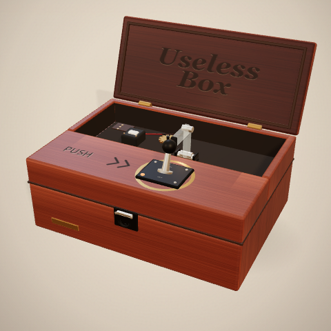

# Useless Box

A Three.js useless box you can share as an X Player Card. Push the switch; the lid opens, an acrylic finger emerges to flip the switch back off, and the box closes again.

The demo is a single static page. Three.js is vendored locally, the wood, felt, acrylic, decals, environment, and shadow textures are procedural, and all sound is synthesized with the Web Audio API. There are no runtime CDN, font, image, or audio requests.

Live page: <https://xyzzyapps.github.io/useless-box/> (GitHub Pages, deployed from `main` at the repository root).



## Run it locally

Requirements: Node.js 22 or newer and a browser with WebGL 2.

No package installation is needed.

```powershell
npm run dev
```

Open <http://127.0.0.1:4173/>.

Use the local server rather than opening `index.html` with `file://`: browsers block native ES-module imports from file URLs. The GitHub Pages deployment is served over HTTPS, so this only affects local testing.

Other commands:

```powershell
npm test        # pure state-machine, timeline, IK, and math tests
npm run check   # syntax check plus embed metadata/vendor validation
```

## Controls

- Click or tap the toggle switch to run the cycle.
- The canvas is focusable; press `Space` or `Enter` to push the switch.
- Use the speaker button in the top-right to mute or unmute the synthesized servo and latch sounds.
- After a cycle, a small `again?` hint appears. Subsequent pushes work immediately.
- For sound design work, open `?soundlab=1` to audition each cue in isolation or replay the full cycle. The panel is debug-only and never appears in the normal card view.

## Embedding in an X post

This follows the same Player Card approach as the Pong template:

| Tag | Value |
| --- | --- |
| `twitter:card` | `player` |
| `twitter:player` | `https://xyzzyapps.github.io/useless-box/` |
| `twitter:player:width` | `480` |
| `twitter:player:height` | `480` |
| `twitter:image` | `https://xyzzyapps.github.io/useless-box/preview.png` |

X loads `twitter:player` in an iframe on desktop web when the Player Card is approved. The page and the canvas fill the iframe and the camera re-fits whenever the iframe is resized. The declared aspect ratio is 1:1, matching the 480x480 `preview.png`.

### Publish

The absolute URLs currently assume this repository:

```text
https://github.com/xyzzyapps/useless-box
https://xyzzyapps.github.io/useless-box/
```

If you publish under a different repository name, update the three absolute URLs in `index.html` (`twitter:image`, `twitter:player`, and `og:image`), plus the hosting comment at the top of the head.

Then:

1. Push to the `main` branch on GitHub.
2. In GitHub repository settings, enable Pages from `main` at `/ (root)`.
3. Keep the included `.nojekyll` file so Pages does not run the files through Jekyll.
4. Confirm `https://xyzzyapps.github.io/useless-box/` loads over HTTPS.
5. Paste that URL into the [X Player Card validator](https://cards-dev.x.com/validator) while logged in to X.
6. Post a **new** link. X caches card metadata; editing an existing post often leaves the old card in place.

The deployment is live and its metadata, scripts, and 480x480 preview were verified over HTTPS. X blocks automated/headless validator requests with HTTP 403, so the final card-validator click has to happen in a normal logged-in browser.

The host must not send `X-Frame-Options: DENY` or `SAMEORIGIN`, and must not set a CSP `frame-ancestors` directive that excludes `https://x.com` and `https://twitter.com`. GitHub Pages works for this.

### Important X caveat

X's written Player Card rules reserve the format for linear audio and video and say not to build a full game inside one. Approval is therefore not guaranteed. If the validator does not show an inline player, the link still works as a normal web page and the post falls back to `preview.png`. The 480x480 preview includes a play affordance when X renders the card as media.

On iOS and Android, X shows the preview image with a play icon rather than an inline iframe. Tapping opens the player page in the in-app browser.

## Query flags

These are useful while tuning or taking the preview:

| URL | Effect |
| --- | --- |
| `?debug=1` | Verbose console logs and `window.__uselessBox` access |
| `?soundlab=1` | Show the debug sound audition panel |
| `?still=1.95` | Freeze the scene at 1.95 seconds into the cycle |
| `?still=idle` | Freeze at the initial closed-box pose |
| `?ui=0` | Hide the hint, speaker button, sound lab, and loading text |
| `?preview=1` | The 1.95-second hero pose with UI hidden; used to make `preview.png` |

Render time is deterministic for a given time value, so stills can be regenerated by opening a still URL in a browser.

## Project layout

```text
index.html                          Player Card shell, CSS, import map, accessibility
src/
  main.js                           Boot, query flags, error fallback
  app/app.js                        Composition root and animation loop
  core/
    interaction-machine.js           Idle/running user-interaction FSM
    math.js                         Easing, damping, clamping, settle
    logger.js                       Debug-gated logging facade
  features/
    box/
      layout.js                     Fixed scene dimensions
      cycle.js                      Deterministic 3.8s timeline and audio cues
      ik.js                         Two-bone IK for the acrylic finger
      model.js                      Wooden box, lid, toggle, arm, interior
      scene.js                      Renderer, camera rig, lighting, table
    interaction/input-controller.js  Raycast input, hover, keyboard
    audio/audio-engine.js            Synthesized mechanical and fax-like cues
    audio/sound-lab.js               Debug cue audition panel
  shared/textures.js                 Procedural wood, felt, labels, env, shadow
tests/                               Node built-in test suite
scripts/
  serve.mjs                          Zero-dependency static dev server
  check.mjs                          Syntax and embed-readiness checks
vendor/                              Pinned Three.js 0.186.1 and MIT license
preview.png                          480x480 X Player Card image
.nojekyll                            GitHub Pages marker
```

## How it works

`index.html` loads the app through a native import map. `UselessBoxApp` owns the interaction state machine, the 3.8-second cycle timeline, the audio engine, the input controller, and one `BoxScene`.

A push only starts the cycle when the interaction FSM is idle. The timeline then drives four visual channels:

- The metal toggle snaps on, then is pushed off by the acrylic finger.
- The rear-hinged lid opens, holds while the finger reaches, then closes.
- The two-bone acrylic finger rises, reaches over the control deck, sweeps the toggle, retracts, and folds back into the cavity.
- The camera eases slightly closer during the action.

Audio cues are scheduled at deterministic times in the same timeline, so the switch clicks, latch tick, motor whirr, and final thunk stay in sync with the motion. The servo voice is built from filtered gearbox noise, a quiet low motor hum, randomized gear chatter, a thin high-frequency hiss, and a short fax-style electronic handshake with a fast warble. There are no pitched sawtooth sweeps, so it reads as a small electromechanical arm rather than a brass instrument. The first pointer or key gesture unlocks the browser's `AudioContext`.

The finger uses analytic two-bone IK in the Y/Z plane. The timeline supplies a target point in scene space; the IK solver returns shoulder and elbow angles. This keeps the fingertip path deterministic and unit-testable.

See [SPEC.md](SPEC.md) for the full requirements, architecture, dimensions, timing table, and verification plan.

## Verification

- 21 unit tests cover easing, the interaction FSM, both-bone IK reach/mirroring/clamping, the complete cycle, cue ordering, final pose, folded-clearance, and lid-before-arm ordering.
- `npm run check` verifies every JavaScript module parses and that the page still has the required Player Card metadata, local Three.js files, and no runtime CDN dependency.
- A headless Chrome smoke test at a forced 480x480 viewport ran against both the local server and the live GitHub Pages URL. It clicked the projected switch position, observed the FSM enter `running`, confirmed the audio context was running, waited for the cycle to return to `idle` at 3.8 seconds, verified the final switch/lid/arm angles, and found no runtime exceptions.
- The revised audio was exercised in Chrome through an analyser, both locally and on the deployed page: every cue produced signal, the peak level stayed below full scale (0.037 to 0.158), and no runtime exceptions were recorded.
- `preview.png` is a real 480x480 render from `?preview=1`.

## Third-party code

Three.js 0.186.1 and its `RoundedBoxGeometry` addon are vendored under `vendor/`. They are MIT licensed; see `vendor/THREE-LICENSE.txt` and `vendor/README.md`. No runtime code was modified in the vendored files.

## License

The project itself is currently marked `UNLICENSED` in `package.json`. Choose and add a license before distributing the project publicly.
