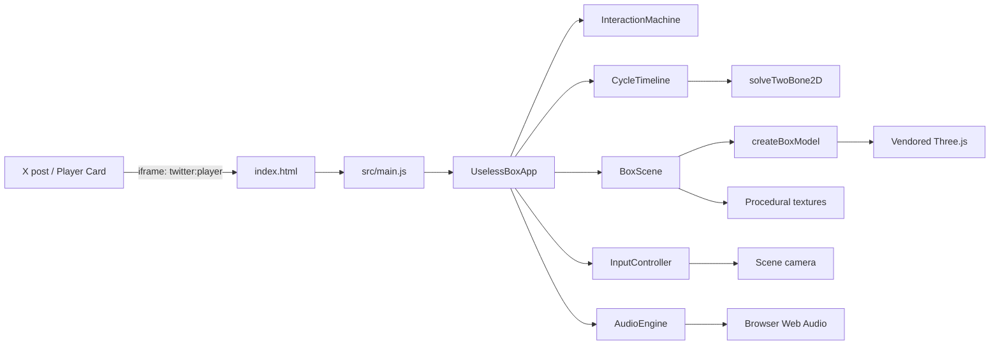
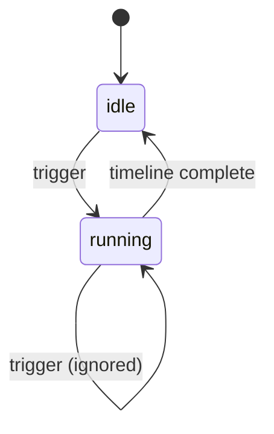
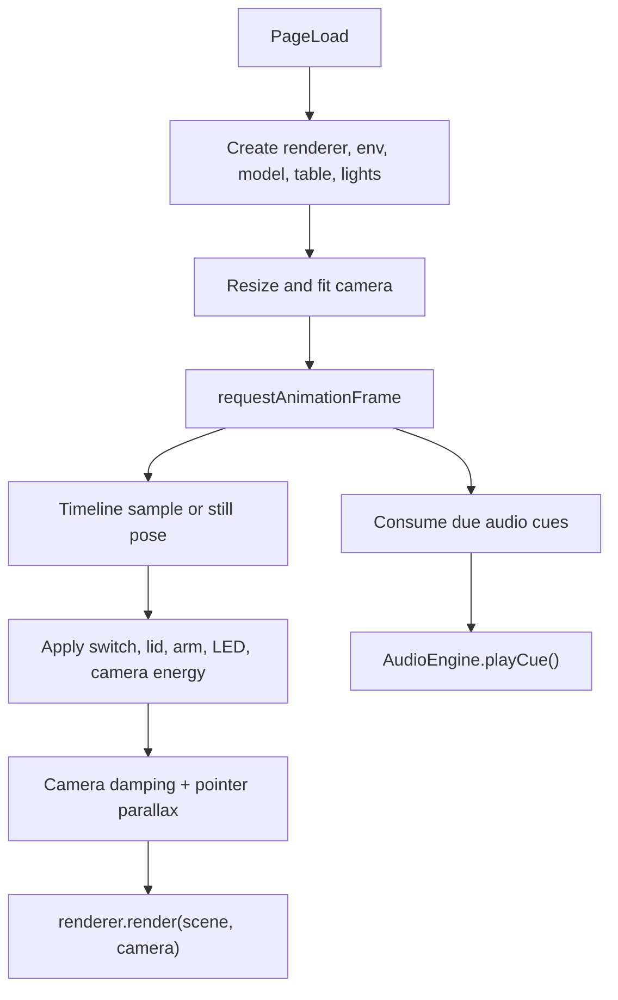

# Useless Box — Software Requirements Specification

Status: implemented, deployed, and verified  
Version: 1.0.0  
Last updated: 2026-10-19  
Live page: https://xyzzyapps.github.io/useless-box/

## 1. Purpose

This document defines the behavior, architecture, visual model, timing, and verification requirements for the Useless Box Three.js demo. It is both the project specification and the handoff document for future maintainers and coding agents.

The deliverable is a static, dependency-light web page that can be embedded through an X Player Card. A user pushes a large toggle switch; the box opens its lid, extends a translucent acrylic finger, flips the switch back off, retracts the finger, and closes. The machine achieves nothing, which is the point.

## 2. Scope

### In scope

- One interactive 3D useless box scene rendered with Three.js.
- A deterministic, repeatable push cycle.
- Pointer, touch, and keyboard activation.
- Procedural wood, felt, labels, contact shadow, and studio environment.
- Synthesized servo, latch, switch, and thunk sounds through Web Audio.
- Responsive framing for a square X Player Card and arbitrary iframe sizes.
- Accessible fallback, mute control, and reduced-motion behavior.
- X Player Card metadata, a 480x480 preview image, and static hosting instructions.
- Pure unit tests and a headless browser smoke verification.

### Out of scope

- A backend, accounts, persistence, analytics, or network APIs.
- Multiplayer or multiple simultaneous boxes.
- Asset pipelines, GLTF models, or downloaded audio.
- Guaranteed X Player Card approval. X controls that policy.
- A full game loop or score. The interaction is a toy, not a win/lose game.
- Mobile-inline playback inside the X feed. X's current mobile behavior opens the card in its in-app browser.

## 3. Product context: X Player Card

The page mirrors the established Pong template.

X reads these tags from the posted URL:

| Tag | Required value | Purpose |
| --- | --- | --- |
| `twitter:card` | `player` | Request an inline player card |
| `twitter:title` | `Useless Box` | Card title |
| `twitter:description` | short sentence | Card description |
| `twitter:image` | absolute HTTPS PNG | Preview/fallback image |
| `twitter:player` | absolute HTTPS page URL | iframe source |
| `twitter:player:width` | `480` | Declared aspect ratio |
| `twitter:player:height` | `480` | Declared aspect ratio |

Constraints:

- The player page must be served over HTTPS.
- The response must not disallow framing by `x.com` and `twitter.com`.
- The preview image must be at least roughly 262x262; this project uses 480x480.
- X scales the iframe in its media column while preserving the declared 1:1 aspect.
- The canvas must fill whatever size the iframe becomes; do not assume the iframe is exactly 480x480 on screen.
- Audio must be unlocked from a user gesture.
- The page must not require login, popups, or local storage.
- The card metadata is cached by X. Post a new URL after changing tags or the preview image.
- X's written rules reserve Player Cards for linear media and discourage games. Approval is not guaranteed. The page must still be a useful normal web page and provide a strong preview image as fallback.

The current absolute URLs are deployed at `https://xyzzyapps.github.io/useless-box/` from GitHub Pages.

## 4. Functional requirements

### FR-1 Initial state

On first load the box is closed, the toggle is in the OFF position, the acrylic finger is folded inside the cavity, the hint reads `PUSH the switch`, and the speaker control is visible. The camera is framed for a square card.

### FR-2 Activation

The user can start the cycle by:

- Clicking or tapping the toggle or its generous invisible hit volume.
- Pressing `Space` or `Enter` while the canvas is focused.
- A future integration calling `UselessBoxApp.trigger()` programmatically.

A programmatic call is allowed; the public method returns a boolean.

### FR-3 Ignore repeated activation

While the cycle is running, additional pointer or keyboard activations do not start a second cycle. Input is disabled for the duration. The machine returns to idle when the cycle completes.

### FR-4 Animation sequence

The full cycle takes 3.8 seconds:

1. The toggle snaps from OFF to ON. The red LED illuminates.
2. The lid latch releases.
3. The rear-hinged lid opens to -1.92 rad.
4. The acrylic finger rises out of the cavity.
5. The finger reaches over the front deck.
6. The finger pushes the toggle forward to OFF. The LED fades.
7. The finger retracts and folds into the cavity.
8. The lid closes.
9. A final thunk and settle complete the cycle.

### FR-5 Repeatability

Every run must end in exactly the same pose: switch OFF, lid closed, finger folded, camera energy zero. The final pose must be identical to the initial pose apart from camera damping and ambient idle motion.

### FR-6 Sound

The page synthesizes:

- A first switch click on activation.
- A latch tick.
- A slow, loaded lid-opening motor with hinge friction.
- A faster arm-rise motor and a higher-load arm-reach motor.
- A switch-off click.
- A reversing arm-retraction motor.
- A descending lid-closing motor and hinge friction.
- A low final thunk.

The motor voice is deliberately not a musical oscillator:

- Broadband gearbox noise through low-Q filters, pulsed by a 20–45 Hz tremolo.
- A quiet 58–90 Hz motor hum plus a weak harmonic.
- A thin 3.2–4.5 kHz gear hiss.
- A faint 1.7–2.7 kHz electronic whine.
- A short high-frequency fax-style handshake at movement start: two high carriers with a fast amplitude warble.
- Randomized short gear-chatter grains.
- Dry start, end-of-travel, and gear-lash clicks.

Sawtooth oscillators and high-Q pitched filter sweeps are intentionally absent; they previously produced a brass-like timbre.

Audio starts on the first pointer or keyboard gesture. No audio file is downloaded. A speaker button toggles mute and updates `aria-pressed`, `aria-label`, and the icon.

### FR-7 Responsive rendering

- The renderer drawing buffer is derived from the stage's client size and `devicePixelRatio` (capped at 2).
- The camera fit distance is recomputed from the viewport aspect ratio, vertical FOV, and a scene bounding radius.
- The composition is centered for square, portrait, and landscape iframes.
- The UI hint uses the bottom safe area and does not overlap the closed box at 480x480.
- Resize does not restart or reset the animation cycle.

### FR-8 Debug and still modes

- `?debug=1` enables verbose logs and exposes `window.__uselessBox`.
- The cue audition sound lab is shown by default. `?soundlab=0` hides it and `?soundlab=1` explicitly enables it.
- `?still=<seconds>` freezes the pose at that cycle time, disables pointer input, and keeps the sound lab unless `ui=0`.
- `?still=idle` or `?still=0` freezes the initial pose.
- `?ui=0` hides the hint, speaker control, sound lab, and loading text.
- `?preview=1` freezes at 1.95 seconds and hides UI. This produced `preview.png`.

### FR-9 Error handling

If module loading, WebGL creation, or first-frame initialization fails, the page displays a friendly fallback panel and sets `data-error="true"`. Runtime render errors after successful initialization are logged, not hidden.

### FR-10 Accessibility

- The canvas has `role="button"`, `tabindex="0"`, an accessible label, and `aria-keyshortcuts="Space Enter"`.
- The canvas label changes to a busy description during the cycle.
- `aria-busy` is updated.
- A visually hidden `role="status"` region announces switch pushes, completion, mute changes, and errors relevant to the user.
- The mute button has a visible focus ring and accessible state.
- The experience remains operable with reduced motion; camera drift/parallax is disabled, while the essential box animation remains.
- The page does not rely on hover for activation.

## 5. Non-functional requirements

### NFR-1 Performance

- Target 60 fps at 480x480 on integrated graphics; degrade gracefully.
- One directional shadow-casting light, 1024x1024 shadow map.
- No post-processing passes.
- Renderer pixel ratio capped at 2.
- Textures generated once at startup; 512px wood textures, 512px contact shadow, 1024x512 environment.
- No transmission pass; acrylic is a semi-transparent PBR material with edge lines. This is a deliberate performance and compatibility decision.

### NFR-2 Dependencies

- Runtime dependency: a locally vendored Three.js 0.186.1.
- No runtime CDN, remote fonts, remote images, or audio files.
- No build step is required. Native ES modules and an import map are used.
- Dev dependencies: none. Static server, syntax checks, and tests use Node built-ins. Node 22+ is required for the test runner's glob handling.

### NFR-3 Browser support

Target modern Chromium (Chrome/Edge), Safari 16.4+, and Firefox 108+:

- WebGL 2.
- ES modules and import maps.
- `ResizeObserver`, pointer events, Web Audio.
- Canvas 2D for procedural textures.

### NFR-4 Maintainability

- Pure simulation modules have no DOM or Three.js imports and are unit-testable in Node.
- Rendering, interaction, audio, and orchestration are separate modules.
- Geometry dimensions are centralized in `src/features/box/layout.js`.
- Timing and cue data are centralized in `src/features/box/cycle.js`.
- Each module has a documentation comment explaining its responsibility.
- Logging is debug-gated to keep production consoles clean.

### NFR-5 Embed safety

The page is static and includes no popups, top-level navigation, storage, cookies, or network calls. It does not send framing headers. GitHub Pages serves it without `X-Frame-Options`.

## 6. Architecture

### 6.1 System context



### 6.2 Composition root

`src/main.js` reads query flags and constructs one `UselessBoxApp`. It installs the fatal-error fallback and exposes the app for debug introspection. `UselessBoxApp` is the only place that wires the feature slices together. It owns:

- the interaction FSM,
- the cycle timeline,
- the audio engine,
- the input controller,
- the box scene,
- the animation loop,
- the hint/status/speaker UI.

### 6.3 Vertical slices

| Slice | Module | Responsibility |
| --- | --- | --- |
| Interaction | `src/core/interaction-machine.js` | Two-state user interaction guard |
| Simulation | `src/features/box/cycle.js` | Deterministic pose channels and cue schedule |
| Simulation math | `src/features/box/ik.js` | Two-bone IK and forward kinematics |
| Scene | `src/features/box/scene.js` | Renderer, lighting, camera rig, table, resize |
| Model | `src/features/box/model.js` | Box, lid, toggle, acrylic finger, mechanism |
| Assets | `src/shared/textures.js` | Procedural maps and studio environment |
| Input | `src/features/interaction/input-controller.js` | Raycast, hover, pointer, keyboard |
| Audio | `src/features/audio/audio-engine.js` | Mechanical/fax-like Web Audio synthesis and mute |
| Sound lab | `src/features/audio/sound-lab.js` | Default cue audition panel, hideable with query/CSS |
| Presentation | `index.html` | Player Card metadata, CSS, overlays, import map |
| Tooling | `scripts/` | Static server and static checks |

### 6.4 Directory structure

```text
index.html
preview.png
package.json
.nojekyll
src/
  main.js
  app/app.js
  core/interaction-machine.js
  core/logger.js
  core/math.js
  features/audio/audio-engine.js
  features/audio/sound-lab.js
  features/box/cycle.js
  features/box/ik.js
  features/box/layout.js
  features/box/model.js
  features/box/scene.js
  features/interaction/input-controller.js
  shared/textures.js
scripts/
  serve.mjs
  check.mjs
tests/
  cycle.test.js
  ik.test.js
  machine.test.js
  math.test.js
vendor/
  three.core.js
  three.module.js
  THREE-LICENSE.txt
  addons/geometries/RoundedBoxGeometry.js
```

## 7. Interaction state machine

### 7.1 States

- `idle`: the switch can be activated.
- `running`: the cycle owns the machine; activations are ignored.

### 7.2 Transitions



Implementation: `src/core/interaction-machine.js`. The transition table is frozen and `trigger()`/`complete()` return booleans.

### 7.3 Trigger sequence

```text
pointer/key trigger
  -> audio.unlock()
  -> machine.trigger()
  -> timeline.start()
  -> consume t=0 cue (switch:on)
  -> hide hint
  -> set aria-busy, disable input
  -> requestAnimationFrame loop applies samples
```

Completion sequence:

```text
timeline.complete
  -> machine.complete()
  -> apply exact final pose
  -> re-enable input
  -> announce completion
  -> show "again?" hint after 650 ms
```

## 8. Cycle timeline

### 8.1 Timing constants

| Event | Time (s) |
| --- | --- |
| Switch ON starts | 0.00 |
| Switch ON complete | 0.14 |
| Latch cue | 0.18 |
| Lid opens | 0.30–1.15 |
| Arm rises | 1.00–1.45 |
| Lid fully open | 1.15 |
| Arm reaches | 1.45–1.95 |
| Arm pushes toggle | 1.95–2.15 |
| Switch OFF starts | 2.00 |
| Switch OFF complete | 2.16 |
| Arm retracts | 2.15–2.55 |
| Arm folds | 2.55–2.90 |
| Lid closes | 2.80–3.55 |
| Thunk | 3.55 |
| Cycle complete | 3.80 |

The lid begins opening before the arm starts moving and closes only after the arm is folded. The arm rise starts while the lid is nearly open but clear of the arm's path.

### 8.2 Animated pose channels

`sampleCycle(t)` returns:

```js
{
  time,              // clamped 0..3.8
  phase,             // switch-on | latched | lid-opening | arm-rising |
                     // arm-reaching | switching-off | arm-retracting |
                     // arm-folding | lid-closing | settling
  switchAngle,       // radians, OFF +0.38 -> ON -0.38
  led,               // 0..1, follows switch state with snap settle
  lidAngle,          // 0 closed, -1.92 open
  arm: { shoulder, elbow }, // local X rotations for the two bones
  cameraEnergy       // 0..1 dolly/focus energy
}
```

The channel functions use easing from `src/core/math.js`:

- Switch: cubic snap with a decaying settle.
- Lid: ease-out open, ease-in-out close, tiny settle.
- Arm rise: ease-out.
- Reach/push/retract: eased IK target interpolation.
- Fold: ease-in joint interpolation.
- Camera: eased energy, smooth-damped in the rig.

### 8.3 Audio cue table

| Time | Cue | Synthesis |
| --- | --- | --- |
| 0.00 | `switch:on` | Impact noise + low body + brief metal tick |
| 0.18 | `latch:click` | Two dry filtered-noise contacts |
| 0.30 | `lid:open` | Slow layered motor + fax chirp + hinge noise |
| 1.00 | `arm:rise` | Fast layered motor + fax chirp + dense gear chatter |
| 1.45 | `arm:reach` | Higher-load motor + shorter fax chirp |
| 2.00 | `switch:off` | Stronger impact click + metal tick |
| 2.15 | `arm:retract` | Reversing motor + descending chirp |
| 2.80 | `lid:close` | Descending motor + hinge friction |
| 3.55 | `thunk` | Low sine drop + low-passed noise + case rattles |

Cues are consumed once by index and are returned in schedule order, even if multiple cues become due in one frame.

### 8.4 Two-bone IK

The acrylic finger is a planar two-bone chain in Y/Z. `solveTwoBone2D`:

- Input: root point, upper and lower lengths, target point, bend sign.
- Clamps the target distance to `[|L1-L2|+epsilon, L1+L2-epsilon]` to avoid singular solutions.
- Computes the shoulder angle from `+Y` toward `+Z`, and the elbow's local rotation.
- Returns the elbow point, tip, reachability, and raw distance.

The layout uses:

```text
root        z=0.02, y=1.14
upper       0.44
lower       0.48 (includes the black tip)
bend        -1 (elbow on the hinge side, above the deck during the reach)
folded      shoulder=-1.70, elbow=0
ready       target z=0.28, y=1.88
contact     target z=0.48, y=1.58
push        target z=0.82, y=1.58
```

`ARM_POSES.ready`, `.contact`, and `.push` are solved once at module load and used by tests. The timeline resolves IK at runtime while targets move.

The folded pose is a straight finger lying back into the cavity. Tests assert that its tip stays above the felt floor (`y > 0.82`), under the closed lid (`y < 1.2`), and inside the cavity (`-1.2 < z < 0.2`).

## 9. Scene model

### 9.1 Coordinate system and dimensions

Right-handed Three.js coordinates. Y is up. The camera views from the front (+Z) and right (+X). The box rests on the table at `y = 0`.

| Element | Dimensions / placement |
| --- | --- |
| Lower carcass | 3.30 wide x 0.80 high x 2.40 deep, centered at y=0.40 |
| Upper rim | Height 0.40 from y=0.80 to 1.20 |
| Wall thickness | 0.12 |
| Cavity | z=-1.20 to 0.16, floor felt at y≈0.816 |
| Control deck | z=0.16 to 1.20, top at y=1.20 |
| Lid | 3.30 x 0.14 x 1.42, hinged at y=1.20, z=-1.20 |
| Lid open angle | -1.92 rad (about -110 degrees) |
| Toggle origin | x=0.35, y=1.20, z=0.72 |
| Toggle scale | 1.4 |
| Toggle plate | 0.46 x 0.032 x 0.38 |
| Lever length | 0.252 plus a 0.07-radius knob |
| Toggle OFF | rotation.x = +0.38 |
| Toggle ON | rotation.x = -0.38 |
| Finger root | x=0.35, y=1.14, z=0.02 |
| Camera target | (0, 0.82, 0) |
| Camera FOV | 33 degrees |
| Camera azimuth | 0.46 rad |
| Camera elevation | 0.53 rad |

### 9.2 Box construction

- The lower carcass is a rounded box with a material array that rotates wood grain for side, top, and front faces.
- The upper rear opening is formed from left/right/back rim panels and a solid front deck. The cavity is real, allowing the finger to rise from inside.
- Felt planes line the floor and inner walls.
- The lid is rear-hinged and has a thin lip and two brass hinge barrels.
- A blackened steel clasp and a small brass maker plate detail the front.
- A pair of brass hinges and visible screws read at the 480px card size.
- The lid has matching printed labels on its outer and inner faces. The inner label is visible in the open state, like the reference photograph.

### 9.3 Toggle switch

- A black metal plate with a brass hover/pulse ring.
- Four chrome screws and an ON/OFF plate print.
- A chrome stem and black spherical knob.
- A red LED with emissive intensity driven by the `led` channel.
- A generous transparent hit volume, roughly 1.15 x 0.77 x 1.06 scene units after the 1.4 scale.

### 9.4 Acrylic finger

- Two tapered translucent segments with rounded edges and bright edge lines.
- Chrome shoulder and elbow collars.
- A black rubber fingertip.
- Bearing block, axle, and mounting ears at the cavity front.
- Material: PBR, roughness 0.045, opacity 0.42, clearcoat 1, environment intensity 2.1, no transmission. Semi-transparent with visible white edges reads better than true refraction at 480px and avoids a transmission render pass.

### 9.5 Interior mechanism

- Black servo body and white horn.
- Flat brass gear with 12 teeth.
- Red and black cable runs using tube geometry.
- Small control board with brass pads.
- These details are visible when the lid is open and reinforce the physical machine.

### 9.6 Materials and textures

Procedural textures are generated at runtime using Canvas 2D:

- **Cherry wood**: warm base gradient, broad wandering grain, fine grain, two knots, speckle noise, and a matching bump map. Color space sRGB for color maps; NoColorSpace for bump maps.
- **Felt**: dark rough material with a procedural bump map.
- **Title decal**: transparent canvas with italic Georgia lettering, engraved highlight, and a hand-drawn rule.
- **PUSH decal**: bold sans text and two chevrons pointing at the toggle.
- **Plate decal**: ON/OFF text on the toggle plate.
- **Contact shadow**: radial elliptical alpha gradient under the box.
- **Studio environment**: equirectangular canvas with warm/cool softboxes, processed through `PMREMGenerator` for chrome and acrylic reflections.

No image files are loaded by the scene.

## 10. Rendering pipeline



### 10.1 Renderer

- `WebGLRenderer` with antialias, alpha, high-performance preference.
- Transparent clear, no scene background; the matte table fills the frame.
- `ACESFilmicToneMapping`, exposure 0.98.
- `outputColorSpace = SRGBColorSpace`.
- `PCFSoftShadowMap`.
- Pixel ratio capped at 2.
- Drawing buffer set from stage size with `setSize(width, height, false)`.

### 10.2 Lighting

- Hemisphere fill: warm sky, brown ground, intensity 0.92.
- Key directional: warm, intensity 1.9, casts 1024px soft shadows.
- Front fill directional: warm, intensity 0.68.
- Back rim directional: cool, intensity 1.0.
- Interior point light: warm, intensity 0.34, distance 3.4.

### 10.3 Camera rig

The camera is positioned on a spherical arc around the target:

```text
distance = max(minDistance, fitRadius / sin(min(vFov/2, hFov/2)) * margin)
fitRadius = 2.25
margin = 1.07
vFov = 33 degrees
```

On resize, the aspect, fit distance, and projection matrix are updated. During idle, the camera drifts within about +/-0.006 rad and follows the pointer by about +/-0.022 rad azimuth and +/-0.014 rad elevation. During the cycle, it eases closer by up to 3.5% and lifts its target by 0.06. Reduced motion and still mode disable drift and parallax.

### 10.4 Table and contact shadow

- A 200x200 matte, warm plaster-colored plane at y=-0.004 catches the key shadow.
- A 4.7x3.6 transparent radial contact shadow grounds the carcass.
- No environment background texture is used; the CSS vignette and floor fill the frame.

## 11. Input and accessibility

### 11.1 Raycast hit volume

`InputController` raycasts against `switchAssembly.hitMesh`, an invisible box scaled with the toggle. The hit volume is intentionally larger than the visible lever to make touch use comfortable. On pointer hover over the hit volume, the canvas gets `is-hovering` (pointer cursor) and the scene's ring brightens.

### 11.2 Pointer logic

- `pointermove` updates NDC and hover state; touch moves do not drive camera parallax.
- `pointerdown`:
  - focuses the canvas,
  - regenerates NDC,
  - calls `onFirstGesture` to unlock audio,
  - checks the hit volume,
  - prevents default and triggers if hit.
- `pointerleave` and `pointercancel` clear hover.
- Non-primary pointers and non-left mouse buttons are ignored.

### 11.3 Keyboard logic

- `Space`, `Enter`, and `NumpadEnter` trigger the switch when the canvas is focused.
- Default scrolling is prevented.
- The canvas is reachable in the tab order.
- The mute button is independently keyboard-operable.

### 11.4 Announcements

A visually hidden live region receives:

- `Switch pushed. The box is opening.`
- `The box turned itself off.`
- `Sound muted.` / `Sound on.`

The canvas label and `aria-busy` reflect the current state.

## 12. Audio implementation

`AudioEngine` creates a single `AudioContext` on the first gesture, with an input compressor (threshold -20 dB, ratio 4:1) and a master gain (0.44). It builds a reusable white-noise buffer and schedules filtered noise, sine/triangle drones, LFOs, grains, and gain envelopes. Sawtooth oscillators are not used.

The `_motor` voice combines:

- A gearbox-noise path: looped noise → bandpass (Q 0.72) → highpass at 280 Hz → tremolo gain modulated at 20–45 Hz → envelope.
- A high-gear hiss path: looped noise → bandpass around 3.2–4.2 kHz (Q 0.52) → envelope.
- A low sine hum at roughly 58–90 Hz, plus a weak triangle harmonic.
- A triangle electronic whine around 1.7–2.1 kHz and a quiet sine fax whine around 2.7–3.2 kHz.
- A stochastic gear-chatter sequence: 2–14 short 2.5–7.5 ms noise grains per movement, with randomized bandpass centers and amplitudes.
- A dry start contact, low current-surge thump, end-of-travel tick, and gear-lash thump.
- `_faxChirp`: two high sine carriers (approximately 2.05–2.27 kHz and 3.0–3.4 kHz) with a 34–46 Hz sine gate, a short exponential envelope, and a direction-dependent sweep.

The `_hinge` voice uses low-Q filtered noise, a slow irregular amplitude modulation, and random stick-slip grains. No high-Q resonator is used, so it cannot produce a musical squeal.

`_switchClick` uses short high-band noise, a filtered low sine body, a very short inharmonic metal tick, and a rebound grain. `_thunk` uses a low sine drop, low-passed noise, and case rattles.

Mute:

- `setMuted(true)` ramps master gain to 0.0001.
- `setMuted(false)` ramps back to 0.44.
- The state is reflected on the speaker button.

The first switch click is scheduled even if `AudioContext.resume()` is still pending; Web Audio plays it when the context starts. This avoids a silent first interaction.

No sound plays before a user gesture because the context is not created until then.

The `SoundLab` cue panel is mounted by default. It imports the cue buttons, unlocks audio on the first audition click, reports the current cue in a live status line, and can replay the full visual/audio cycle. It is hidden by `?soundlab=0`, by `?ui=0`, and in preview/UI-less captures. A still pose without `ui=0` keeps the panel visible. The close button collapses it for the current session.

## 13. Testing and verification

### 13.1 Unit tests

Run with `npm test`. Node's built-in test runner is used; no test framework dependency.

Coverage:

- `tests/math.test.js`: clamping, interpolation, inverse lerp, easing endpoints, damp behavior.
- `tests/machine.test.js`: idle/running transitions, ignored repeated triggers, completion, re-trigger.
- `tests/ik.test.js`: exact target reach, both bend directions, unreachable target clamping, singular-target safety.
- `tests/cycle.test.js`:
  - initial pose,
  - switch ON and OFF timing,
  - LED state,
  - lid opening/closing before/after arm movement,
  - arm pose finite values and contact target,
  - folded finger clearance above felt and below closed lid,
  - lid open before the reach,
  - phase naming across the whole cycle,
  - every audio cue fires exactly once in order,
  - stopped timelines do not run or consume cues.

### 13.2 Static checks

`npm run check`:

- runs `node --check` on every JavaScript module under `src/`, `tests/`, and `scripts/`,
- parses `package.json`,
- confirms required Player Card meta tags and the import map,
- rejects runtime CDN references,
- confirms vendored Three.js files and `.nojekyll` exist.

### 13.3 Browser smoke verification performed

A headless Chrome session was driven over the DevTools Protocol with a forced 480x480 viewport:

- `data-ready` became true,
- the initial FSM state was `idle`,
- the renderer had produced frames,
- a click at the projected switch center entered `running`,
- the audio context reached `running`,
- the cycle returned to `idle` at timeline time 3.8,
- final switch angle was +0.38, lid angle 0, arm shoulder -1.70,
- no runtime exceptions were observed.

The curated `preview.png` was captured from `?preview=1` at 480x480.

An audio-specific headless Chrome pass then exercised every cue through an `AnalyserNode`, both locally and on the deployed page. All cues produced signal, the peak output stayed between 0.037 and 0.158 (well below full scale), the sound lab mounted with the expected buttons, and no runtime exceptions were recorded. This verifies level safety and routing, not subjective timbre; the sound lab remains the review surface for tonal judgment.

### 13.4 Deployment verification

The static site is live at `https://xyzzyapps.github.io/useless-box/`, served by GitHub Pages from `main` at `/`. The deployment was verified over HTTPS:

- The page returns HTTP 200 with `text/html`.
- `preview.png` returns HTTP 200 and is 480x480.
- The vendored Three.js modules and the player entry module return HTTP 200 with JavaScript MIME types.
- The response has no `X-Frame-Options` and no restrictive `Content-Security-Policy`.
- The live HTML contains the expected Player Card and Open Graph metadata.
- A live 480x480 headless smoke test clicked the switch, observed the FSM run, completed at timeline 3.8, returned to idle, and reported no runtime exceptions.
- The mechanical/fax-style sound revision is deployed from commit `d7375c7`. Every cue was exercised on the deployed page; all produced signal, peaks stayed at 0.037–0.158, and no runtime exceptions were recorded.

### 13.5 Manual checks still recommended

- Listen to the synthesized audio on speakers and headphones; verify gain balance.
- Test on an actual iPhone Safari / Android Chrome in the X in-app browser.
- Validate the card at X's card validator in a normal logged-in browser. A headless check was attempted, but x.com returned HTTP 403 to the automated browser, so this step could not be completed programmatically.
- Re-check the layout at a narrow iframe (for example 300x300) and in standalone portrait.

## 14. Deployment

1. Commit the project to a GitHub repository.
2. Ensure Pages serves from `main` at the repository root.
3. Keep `.nojekyll` so Pages serves the static files directly.
4. Update absolute URLs in `index.html` if the repository name is not `useless-box`.
5. Visit the live HTTPS URL and confirm the canvas loads without console errors.
6. Validate `https://<user>.github.io/<repo>/` in X's Player Card validator.
7. Create a new post with the live URL.

Do not add `X-Frame-Options` or a restrictive `frame-ancestors` CSP. The included dev server intentionally omits both.

## 15. Debugging

- Use `?debug=1` for verbose console output.
- Inspect `window.__uselessBox`:
  - `machine.state`
  - `timeline.time`, `.playing`, `.complete`
  - `scene.model.switch.pivot.rotation.x`
  - `scene.model.lidPivot.rotation.x`
  - `scene.model.arm.shoulder.rotation.x`
  - `scene.renderer.info.render`
- Freeze a pose with `?still=<seconds>&ui=0`; use browser devtools to inspect the scene.
- The sound lab is visible by default; audition each cue or the full cycle there. Use `?soundlab=0` to hide it.
- Regenerate the preview with a headless browser pointed at `?preview=1` at 480x480.
- The dev server prints its URL, debug URL, and preview still URL.

## 16. Decision log

| Decision | Rationale |
| --- | --- |
| Static native modules, no build step | Matches the single-file Pong template's spirit while keeping code modular; GitHub Pages can serve files directly. |
| Vendored Three.js | Avoids runtime CDN failure and keeps the player card self-contained. |
| 480x480 Player Card | Matches the established template and gives a comfortable square composition. |
| Rear-hinged lid with split deck | Keeps the user control exposed while allowing a physical acrylic finger to rise from a real cavity. |
| Two-bone IK | Makes the finger reach deterministic, testable, and easy to tune. |
| Semi-transparent PBR acrylic instead of transmission | Reliable at small sizes, significantly cheaper, no extra render pass, still reads as frosted acrylic. |
| Fully procedural textures/audio | No asset hosting, no decoding, no licensing beyond Three.js. |
| Synthesized Web Audio | Small, responsive, and works from the first gesture without audio files. |
| Debug-gated logging | Profuse traces during development without polluting a shared embed's console. |
| Responsive camera fit, not fixed 480 buffer | The iframe is scaled by X and can have an arbitrary on-screen size. |

## 17. Known limitations and future work

- X Player Card approval is outside the project's control and may not be granted for an interactive 3D demo.
- X mobile currently opens the player externally instead of inline.
- Safari and Firefox render Web Audio and PBR slightly differently; manual audio and color checks are recommended.
- The acrylic is stylized as translucent frosted plastic rather than physically refracted glass.
- The interior mechanism is decorative; the gear and servo do not simulate real torque.
- There is no persistence, score, or alternate behavior; the box is intentionally useless.
- Future work:
  - Add subtle gear rotation coupled to the arm pose.
  - Add an optional ambient room tone with a user-controlled toggle.
  - Add a prefers-contrast theme.
  - Add automated screenshot diffing for the preview.
  - Provide a small CLI to publish the static site and open the X validator.

## 18. Public API

`UselessBoxApp`:

```js
new UselessBoxApp({
  canvas,        // HTMLCanvasElement
  stage,         // container element used for resize
  hint,          // hint element
  status,        // aria-live element
  soundButton,   // HTMLButtonElement
  soundLab = null, // cue panel container; mounted by default
  debug = false,
  stillTime = null,
  hideUi = false,
  reducedMotion = false,
})

app.trigger(source) // returns true if a cycle started
app.dispose()
```

`UselessBoxApp` also exposes:

- `machine`
- `timeline`
- `audio`
- `scene`
- `input` (null in still mode)
- `soundLab` (null when hidden by `?soundlab=0`, `?ui=0`, or preview/still capture settings)
- `idlePose`

Abstractions:

- `InteractionMachine`: `state`, `isIdle`, `isRunning`, `trigger()`, `complete()`, `reset()`.
- `CycleTimeline`: `start()`, `update(dt)`, `sample()`, `consumeCues()`, `time`, `playing`, `complete`.
- `sampleCycle(t)`: pure pose sampling.
- `solveTwoBone2D({ root, lengths, target, bend })`: pure IK.
- `createBoxScene({ canvas, logger, reducedMotion })`: returns scene, camera, renderer, model, lights, rig, pose/resize/update/render methods.
- `AudioEngine`: `unlock()`, `setMuted()`, `playCue()`, `dispose()`, `supported`, `muted`, `ctx`.
- `mountSoundLab({ container, audio, onCycle, logger })`: creates the debug cue panel and returns a disposable handle.
- `InputController`: `setEnabled()`, `refreshHover()`, `dispose()`.
